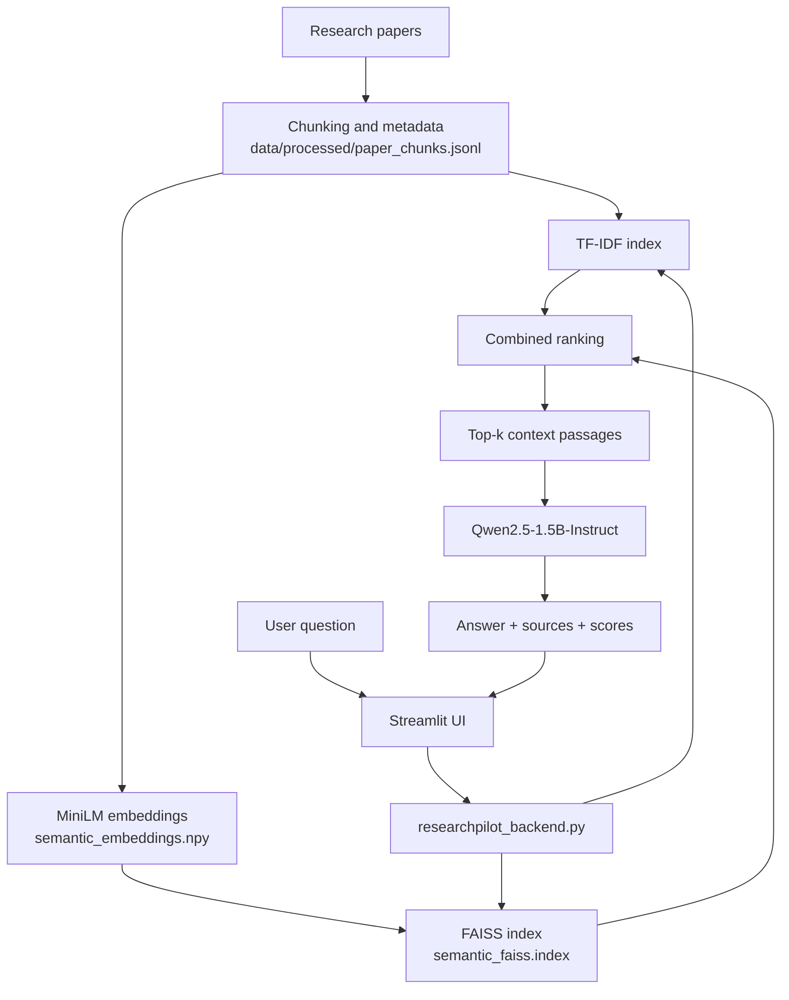

<div align="center">

# ResearchPilot

**An Evidence-Backed Research Assistant Powered by Retrieval-Augmented Generation**


</div>

---

Technical research papers are dense, and finding the exact passage that answers a question can be slow. **ResearchPilot** is a research-question interface that retrieves relevant passages from an indexed collection of research papers and uses them as context for a **local language model** to generate an answer, shown together with its sources.

The project combines TF-IDF keyword retrieval, semantic sentence embeddings, FAISS vector similarity search, Retrieval-Augmented Generation (RAG), source references, and a small retrieval evaluation. It is a portfolio project built to demonstrate how document retrieval, vector indexing, and language generation fit together in a working application.

---

## Project Demo

<!--
REPLACE THE LINE BELOW with the exact URL GitHub generates for your video.

How to get it:
1. Open this README in GitHub's web editor (pencil icon -> Edit).
2. Drag your demo video file (.mp4 / .mov, under 100 MB) into the editor.
3. GitHub inserts a URL like https://github.com/user-attachments/assets/<id>
4. Keep that URL on its own line, exactly as generated. GitHub renders it as an inline video player.
-->

[INSERT GITHUB-GENERATED VIDEO URL HERE]

*The demo shows a research question being entered in the Streamlit interface, the system retrieving relevant passages from the indexed papers, the local model generating an answer, and the retrieved sources being displayed alongside it.*

---

## System Workflow

<!-- Replace the path below with the real location of your committed workflow image. -->

<p align="center">
  
</p>

**How the pipeline works**

1. The user enters a research question in the Streamlit interface.
2. The question is prepared for retrieval: it is embedded with the sentence-embedding model and also used as a TF-IDF query.
3. TF-IDF retrieval and semantic retrieval each surface relevant paper chunks, and their rankings are combined.
4. FAISS performs similarity search over the stored chunk embeddings.
5. The top passages are assembled into a context block (the number of passages is user-adjustable, 1 to 5).
6. The local language model generates a research-oriented answer from that context.
7. The interface displays the answer, source references (arXiv ID, page, paper link), and retrieved passages.

---

## Table of Contents

- [Key Features](#key-features)
- [Research Paper Collection](#research-paper-collection)
- [Technology Stack](#technology-stack)
- [System Architecture](#system-architecture)
- [Retrieval Evaluation](#retrieval-evaluation)
- [Installation](#installation)
- [Usage](#usage)
- [Limitations](#limitations)
- [Future Improvements](#future-improvements)
- [References](#references)


---

## Key Features

| Feature | Description |
|---|---|
| Evidence-oriented Q&A | Answers are generated from retrieved paper passages rather than from the model alone |
| Semantic retrieval | Sentence embeddings capture meaning beyond exact keyword overlap |
| Keyword retrieval | TF-IDF retrieval handles exact terminology and acronyms |
| FAISS vector search | Fast similarity search over precomputed chunk embeddings |
| Local LLM inference | `Qwen/Qwen2.5-1.5B-Instruct` runs on your own machine; no external LLM API |
| Retrieval-Augmented Generation | Retrieved passages are passed to the model as grounding context |
| Source references | Arxiv ID, page number, and paper link shown for retrieved passages where available |
| Passage inspection | Retrieved passages and relevance scores can be reviewed in the interface |
| Adjustable context size | Slider to choose how many source passages (1 to 5) are used |
| Retrieval evaluation | Hit Rate@5 and Mean Reciprocal Rank on a small project-specific query set |

ResearchPilot searches only its indexed papers. It does not perform live internet search and does not guarantee correct or hallucination-free answers.

---

## Research Paper Collection

ResearchPilot currently indexes six papers that cover the foundations of the techniques the project itself uses.

| # | Paper | Relevance to the project |
|---|---|---|
| 1 | *Attention Is All You Need* | Transformer architecture underlying modern language models |
| 2 | *BERT: Pre-training of Deep Bidirectional Transformers for Language Understanding* | Pre-trained bidirectional encoders, the basis of Sentence-BERT |
| 3 | *Billion-scale similarity search with GPUs* | The FAISS approach to efficient vector similarity search |
| 4 | *Dense Passage Retrieval for Open-Domain Question Answering* | Dense retrieval compared with sparse methods such as TF-IDF |
| 5 | *Retrieval-Augmented Generation for Knowledge-Intensive NLP Tasks* | The RAG paradigm that this project implements |
| 6 | *Sentence-BERT: Sentence Embeddings using Siamese BERT-Networks* | Sentence embeddings used for semantic retrieval |

> The application searches this limited collection, not all academic literature.

---

## Technology Stack

| Technology | Purpose |
|---|---|
| Python | Main programming language |
| Streamlit | User interface |
| PyTorch | Model inference and tensor operations |
| Hugging Face Transformers | Loading the language model |
| Sentence Transformers | Generating semantic embeddings |
| FAISS | Vector similarity search |
| Scikit-learn | TF-IDF retrieval and related utilities |
| NumPy | Numerical arrays and embeddings |
| Jupyter Notebook | Chunk building and model experimentation |

<!-- LangChain was listed in the project brief. Add a row ONLY if the code actually imports and uses it. -->

**Models**

| Role | Model |
|---|---|
| Embedding model | `sentence-transformers/all-MiniLM-L6-v2` |
| Language model | `Qwen/Qwen2.5-1.5B-Instruct` |

---

## System Architecture



**Component responsibilities**

| Component | Responsibility |
|---|---|
| Processed chunks and metadata | Paper text split into passages with source, arXiv ID, and page information |
| TF-IDF retrieval | Keyword-based ranking of chunks |
| Embedding generation | Converts chunks and queries into vectors with MiniLM |
| FAISS index | Similarity search over the stored chunk embeddings |
| Context selection | Takes the top-ranked passages as grounding context |
| Local language model | Generates the answer from the question and context |
| Formatting | Presents the answer with source references and scores |
| Streamlit frontend / backend | `app.py` handles the UI; `researchpilot_backend.py` handles retrieval and generation |

---

## Retrieval Evaluation

| Metric | Result |
|---|---|
| Evaluation queries | 5 |
| Hit Rate@5 | 100% |
| Mean Reciprocal Rank (MRR) | 1.0000 |

These results come from a **small, project-specific evaluation set** of five queries. They should not be read as proof of general retrieval performance or of answer correctness. Larger, independently labeled evaluation is listed under [Future Improvements](#future-improvements).

---

## Installation

These instructions are for **Windows PowerShell**.

**1. Open the project folder**

```powershell
cd C:\Projects\ResearchPilot
```

**2. Activate the virtual environment**

```powershell
.\.venv\Scripts\Activate.ps1
```

If PowerShell blocks the script, run this once for the current session and try again:

```powershell
Set-ExecutionPolicy -Scope Process -ExecutionPolicy Bypass
```

**3. Install dependencies**

```powershell
pip install -r requirements.txt
```

If `requirements.txt` does not exist yet, create it from your working environment and check it before committing:

```powershell
pip freeze > requirements.txt
```

**4. Model downloads**

The embedding model and the language model are loaded from local files. On first use they may need to be downloaded from Hugging Face, which requires an internet connection and several gigabytes of disk space.

**GPU note**

GPU acceleration needs a compatible NVIDIA driver and a CUDA-enabled PyTorch build. This project was tested on an NVIDIA GeForce RTX 5050 Laptop GPU with PyTorch `2.9.1+cu128`. Your hardware and setup may differ.

---

## Usage

```powershell
cd C:\Projects\ResearchPilot
.\.venv\Scripts\Activate.ps1
cd streamlit_ui
streamlit run app.py
```

Streamlit prints a local address (usually `http://localhost:8501`). Open it, type a question, choose how many source passages to use, and review the generated answer and the retrieved sources.

**Example questions**

- What is Retrieval-Augmented Generation, and why is it useful?
- How does Dense Passage Retrieval identify relevant passages?
- How does FAISS support efficient similarity search?
- What is the difference between TF-IDF retrieval and semantic retrieval?
- How does Sentence-BERT generate sentence embeddings?
- What limitations of RAG are discussed in the indexed research papers?

Answers depend on the indexed content and on retrieval quality.

---


## Limitations

- Only six papers are indexed.
- Answer quality depends on both retrieval relevance and the small local model's generation.
- Citations should be checked against the original papers.
- The evaluation set is small (5 queries).
- Local inference needs suitable system resources; speed on CPU will be much lower than on a GPU.
- Questions outside the indexed collection may not be answered reliably.

---

## Future Improvements

*Planned, not yet implemented:*

- [ ] Expand the research paper collection
- [ ] Evaluate retrieval with more queries and verified relevance labels
- [ ] Systematically compare TF-IDF, semantic, and combined retrieval
- [ ] Improve citation validation and grounding checks
- [ ] Add document upload and indexing
- [ ] Measure latency and memory usage
- [ ] Improve error handling and deployment readiness

---

## References

- Vaswani et al., *Attention Is All You Need*
- Devlin et al., *BERT: Pre-training of Deep Bidirectional Transformers for Language Understanding*
- Johnson et al., *Billion-scale similarity search with GPUs*
- Karpukhin et al., *Dense Passage Retrieval for Open-Domain Question Answering*
- Lewis et al., *Retrieval-Augmented Generation for Knowledge-Intensive NLP Tasks*
- Reimers and Gurevych, *Sentence-BERT: Sentence Embeddings using Siamese BERT-Networks*

<!-- Add a License section only if a LICENSE file exists in the repository. -->
